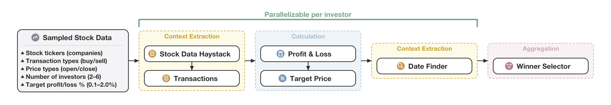
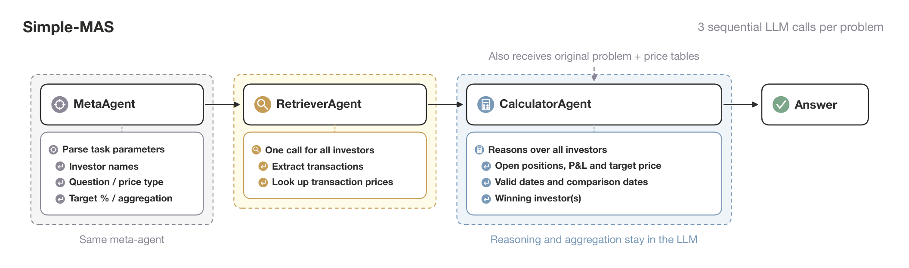
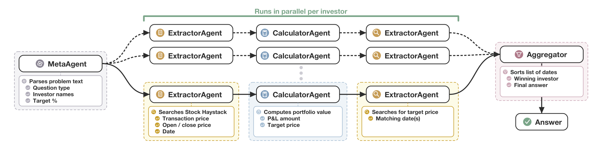
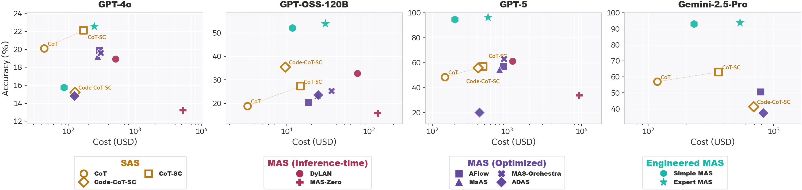

# The Illusion of Automatically Orchestrated Multi-Agent Advantage

SMFR (**Synthetic Multi-Hop Financial Reasoning**) benchmark, CoT/CoT-SC and
Code-CoT/Code-CoT-SC baselines, and our Simple-MAS and Expert-MAS systems.
This release includes our data generator, prompts, runners, evaluator, and
paper figures. Automated MAS implementations and third-party benchmark
datasets must be obtained from their original authors.

## Three-tier evaluation

| Tier | Reference | What it tests |
|---|---|---|
| **1 · Cost-efficiency floor** | **CoT-SC** | Multiple single-agent reasoning draws with answer voting establish the accuracy/cost reference. |
| **2 · Context-separation anchor** | **Simple-MAS** | A three-call meta → retrieval → calculation pipeline tests retrieval/reasoning separation without deterministic financial scaffolding. |
| **3 · Topological-ceiling reference** | **Expert-MAS** | Investor-specific decomposition, parallel reasoning branches, and deterministic position tracking and winner aggregation provide an engineered reference. |

These anchors distinguish additional sampling, context separation, and
engineered decomposition when assessing automated MAS. “Topological ceiling”
names the expert-designed reference, rather than a formal upper bound.
**Code-CoT-SC** is an additional control for code generation and execution.
Compare systems using the same backbone, problems, and documented protocol.

## Installation

Python **3.10+** (validated on 3.12):

```bash
git clone https://github.com/SalesforceAIResearch/Automated-MAS-Illusion.git
cd Automated-MAS-Illusion
python3 -m venv .venv
source .venv/bin/activate
pip install -r requirements.txt
python -m scripts.verify_release
python -m unittest discover -s tests -v
```

[requirements.txt](requirements.txt) installs this package and the dependencies
declared in [pyproject.toml](pyproject.toml). Optional extras:

```bash
pip install -e '.[vertex]'      # Gemini through Vertex AI
pip install -e '.[generation]'  # Generate new synthetic problems
```

[requirements-validated.txt](requirements-validated.txt) records dependency
versions used for the offline checks. Verification and tests make no API calls.

## Dataset



The pinned v2 test set has **588 problems**: 96, 96, 104, 152, and 140 for
2–6 investors, respectively. The **16 validation cases are disjoint** and are
excluded from test accuracy. Files are ordinary gzip JSONL; Git LFS is not needed.

```python
from evaluation.common.data import dataset
for investors, sample in dataset():
    problem, gold = sample["problem"], sample["answer"]
```

See the [data card and generation instructions](dataset/README.md) and
[checksums](dataset/MANIFEST.json). Investor count varies jointly with context
size and transaction complexity. Use the pinned files to compare with the paper;
regenerating from live financial sources can produce different problems.

## Run the three tiers

**Simple-MAS — context-separation anchor**



**Expert-MAS — topological-ceiling reference**



```bash
cp .env.example .env
```

Fill only the credentials for your provider. Runners support OpenAI-compatible
APIs, Together, OpenRouter, and native Vertex AI. For Vertex, set
`GOOGLE_CLOUD_PROJECT` in `.env` and run
`gcloud auth application-default login`.

The following Gemini examples each run **one repetition** over all 588 cases:

```bash
# Tier 1: CoT-SC, k=3
python -m evaluation.SAS.SMFR.run_baseline \
  --protocol gemini_cot --provider vertex --model gemini-2.5-pro \
  --k 3 --workers 8 --output outputs/gemini_cot_sc_0

# Tier 2: Simple-MAS
python -m evaluation.run_mas \
  --system simple --provider vertex --model gemini-2.5-pro \
  --workers 4 --output outputs/gemini_simple_0

# Tier 3: Expert-MAS
python -m evaluation.run_mas \
  --system expert --provider vertex --model gemini-2.5-pro \
  --workers 4 --max-calls 16 --output outputs/gemini_expert_0
```

Add `--limit 2 --dry-run` to any command to check configuration without requests;
remove `--dry-run` for a two-case smoke run. Full runs incur provider charges.
For another repetition, use a new output directory and `--run-id 1` (then 2).
Rerun the same command to resume checkpoints. Create `outputs/<run>/STOP` to
stop scheduling new work; active requests finish. Transient API errors get at
most six attempts; malformed successful responses are retained without resampling.

For **CoT**, use `--k 1`. For **Code-CoT-SC**, use
`--protocol gemini_code_cot --k 3 --execute-code`. Model-answer and executed-code
votes are separate metrics from the same generations. Generated programs run
in a timeout worker with an import allowlist, which is not an OS security
sandbox; use an isolated environment without credentials for execution.

For other models and historical settings, see the
[baseline presets](evaluation/SAS/SMFR/README.md),
[Simple-MAS](evaluation/simple_MAS_for_smfr_dataset/README.md),
[Expert-MAS](evaluation/expert_MAS_for_smfr_dataset/README.md), and
[protocol guide](docs/protocols.md). Historical and controlled baselines are
separate experiments. Each run saves raw responses, manifests, usage, and timing.
Supply `--input-rate` and `--output-rate` in USD per million tokens for an
estimate when the provider does not report cost; otherwise cost is unavailable.

## Evaluate saved outputs

```bash
# Score a new run (also works for baseline or Expert-MAS outputs)
python -m scripts.evaluate --outputs outputs/gemini_simple_0/outputs.jsonl

# Score the executed-code vote from a --execute-code baseline run
python -m scripts.evaluate --outputs outputs/gemini_code_0/outputs.jsonl --metric execution
```

The evaluator joins predictions to canonical problems by SHA-256. Missing or
malformed outputs count incorrect against the full 588-case test set; false
ties are penalized. For a custom or validation split, supply `--reference PATH`.

## Results from the paper



The figure uses the paper's plot directly. Click it to view at full size.
See the paper for accuracy tables, standard deviations, costs, and significance
analysis, and the [protocol guide](docs/protocols.md) for accounting details.
The executable release covers our standalone baselines and engineered systems;
automated MAS implementations shown for comparison are obtained separately.
New generations can vary with sampling and provider behavior.

## License

Code and dataset are licensed under **CC BY-NC 4.0**. See the
[code license](LICENSE.txt), [dataset license](dataset/LICENSE), and
[NOTICE](NOTICE) for attribution.
